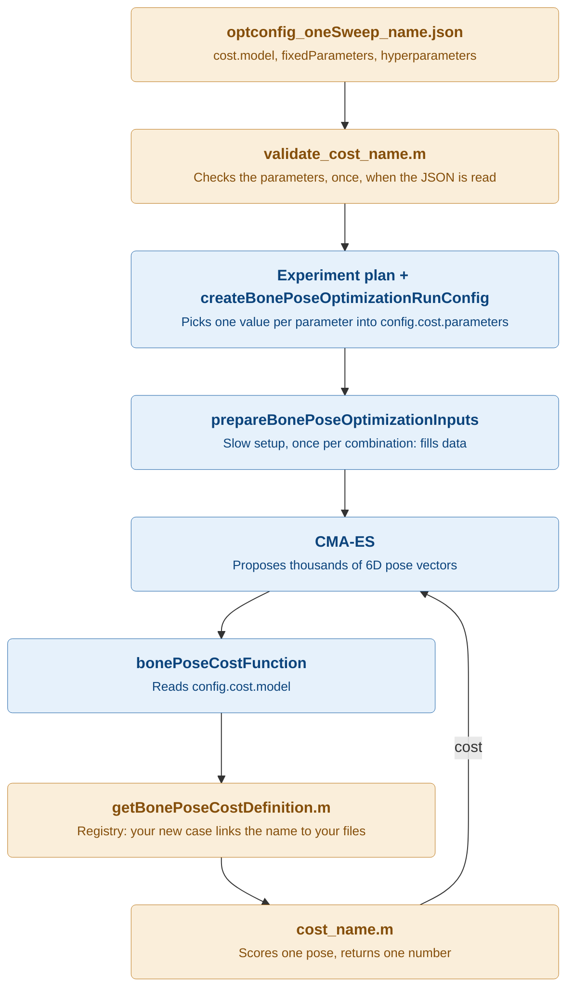

# Adding a new cost function

A cost model answers one question: "how well does the bone, placed at this candidate pose, agree with the ultrasound data?" CMA-ES proposes thousands of candidate poses, and for each one it asks the cost model for a single number. **Lower is better.** Adding a model means writing two small MATLAB files, adding one `case` to a registry, and writing one JSON config. You never change the optimizer or the experiment runner. This page walks you through all of it with one small example model, from an empty folder to a working run.

## 1. The big picture

The diagram shows where your pieces plug in. Orange boxes are what you add or change. Blue boxes already exist, and you leave them as they are.



Colours: orange boxes are **what you add or change**, blue boxes are **fixed framework code**.

Two things in this picture are worth remembering:

- **The validator runs once, the evaluator runs thousands of times.** So all checking belongs in the validator, and the evaluator only does the maths.
- **The registry is used by both sides.** Configuration loading asks it for your validator, and the dispatcher asks it for your evaluator. One `case` therefore makes your model known everywhere.

### 1.1. The files you add

| What | Where | Purpose |
| --- | --- | --- |
| Evaluator `cost_<name>.m` | `functions/bonePoseOptimization/costModels/` | Scores one candidate pose |
| Validator `validate_cost_<name>.m` | `functions/bonePoseOptimization/costModels/` | Checks the model's settings from the JSON |
| One `case` | `functions/bonePoseOptimization/costModels/getBonePoseCostDefinition.m` | Links the model name to both files |
| Config template `optconfig_oneSweep_<name>.json` | `config/` | A complete, working set of settings |
| Config template `optconfig_hyperparamSweep_<name>.json` | `config/` | Only if the model has hyperparameters worth sweeping |
| *Optional:* prepared data | `prepareBonePoseOptimizationInputs.m` | Only if the model needs slow setup that doesn't exist yet |

## 2. Before you start: pick a name

Choose one camelCase name that **describes what the model measures**, and use it in every file name from the table above. Never add a version suffix such as `_v2`: a version number says only *that* something changed, while a descriptive name says *what* changed.

For the example on this page the name is `nearestVertexDistance`:

| Piece | Name |
| --- | --- |
| Registry key and `cost.model` | `nearestVertexDistance` |
| Evaluator | `cost_nearestVertexDistance.m` |
| Validator | `validate_cost_nearestVertexDistance.m` |
| Config templates | `optconfig_oneSweep_nearestVertexDistance.json`, `optconfig_hyperparamSweep_nearestVertexDistance.json` |

The full naming rules, including combined models and retiring old ones, are in [section 5](#5-naming-rules-in-detail).

## 3. Walkthrough: a small example model

The example model `nearestVertexDistance` is a simpler cousin of `ICPLike`. It is only a teaching example and is not in the repository. For every measured ultrasound bone point, it finds the nearest CT mesh vertex at the candidate pose, and returns the mean distance. Each distance is capped at `distanceCapMm`, so a few badly segmented points cannot dominate the cost.

It has one setting of each kind:

- **Fixed parameter** `pointStride`: use every n-th measured point, to make the cost faster. It has one value for the whole experiment.
- **Hyperparameter** `distanceCapMm`: the cap on each distance. The JSON gives a list of candidate values, and the sweep tries each of them.

Keep [`cost_ICPLike.m`](../functions/bonePoseOptimization/costModels/cost_ICPLike.m) and [`validate_cost_ICPLike.m`](../functions/bonePoseOptimization/costModels/validate_cost_ICPLike.m) open next to this page. They are the closest real models to copy from.

### 3.1. Write the evaluator

The evaluator is the function CMA-ES calls for every candidate pose. Every evaluator has the same signature:

```matlab
[cost, details] = cost_<name>(poseVector, data, config)
```

Its three inputs are:

- **`poseVector`**: a 6×1 *correction* `[tx; ty; tz; rx; ry; rz]` (mm and radians) on top of the coarse start pose `data.T_CT_ref_initial`. A zero vector means "exactly the start pose". `stateVectorToTMatrix` turns it into the 4×4 candidate transform `T_CT_ref_candidate`. Almost every evaluator starts with this call. [Processing workflow](workflow.md#31-the-6d-pose-vector-statevectortotmatrix) explains the idea in more detail.
- **`data`**: everything `prepareBonePoseOptimizationInputs` built once before the search. The fields you will use most are `data.boneMeshCT` (the CT mesh), `data.imagePlanesRef` (the ultrasound images and their planes), `data.boneSurfaceMeasurements` (segmented bone points in the ref frame), `data.T_CT_ref_initial`, and model-specific data under `data.extra.<model>`.
- **`config`**: the settings of this one run. Your model's settings are in `config.cost.parameters.<parameterName>`. The fixed parameters and the current value of each hyperparameter arrive there side by side, so the evaluator never needs to know which kind a setting is. The optimizer sometimes calls without `config`, so fall back to `data.config` when it is missing.

Its two outputs are:

- **`cost`**: one finite number; lower is better.
- **`details`**: a struct with whatever helps you understand the number afterwards. It is saved for the best pose, so put in what you would want to plot or check.

Create `functions/bonePoseOptimization/costModels/cost_nearestVertexDistance.m`:

```matlab
function [cost, details] = cost_nearestVertexDistance(poseVector, data, config)
%COST_NEARESTVERTEXDISTANCE Score one candidate pose by point-to-vertex distance.
% For every measured ultrasound bone point, this evaluator finds the nearest
% CT mesh vertex at the candidate pose and averages the distances. Each
% distance is capped, so a few badly segmented points cannot dominate the
% cost. It is a simpler cousin of cost_ICPLike.
%
% Inputs:
%   poseVector - Six-value perturbation [tx; ty; tz; rx; ry; rz] (mm, rad)
%                around data.T_CT_ref_initial.
%   data       - Prepared data from prepareBonePoseOptimizationInputs. This
%                function uses data.T_CT_ref_initial,
%                data.boneSurfaceMeasurements, and the CT-frame KD-tree
%                data.extra.icpLike.vertexTreeCT.
%   config     - Runtime configuration; data.config when omitted. This
%                function uses config.cost.parameters.pointStride and
%                config.cost.parameters.distanceCapMm.
%
% Outputs:
%   cost       - Mean capped point-to-vertex distance in mm. Lower is better.
%   details    - Struct with the candidate transform, the per-point
%                distances, the settings used, and a status string.

%% READ THE SETTINGS

% The optimizer usually passes only the pose and the data, so the config
% saved with the data is used when none is given.
if nargin < 3 || isempty(config)
    config = data.config;
end
poseVector    = poseVector(:);
pointStride   = config.cost.parameters.pointStride;
distanceCapMm = config.cost.parameters.distanceCapMm;

%% BUILD THE CANDIDATE TRANSFORM

% Turn the 6D correction into the candidate CT -> ref transform. Its inverse
% moves the measured points into CT, the frame the KD-tree was built in.
T_CT_ref_candidate = stateVectorToTMatrix(poseVector, data.T_CT_ref_initial);
R_CT_ref = T_CT_ref_candidate(1:3, 1:3);
t_CT_ref = T_CT_ref_candidate(1:3, 4);
T_ref_CT_candidate = [R_CT_ref.', -R_CT_ref.' * t_CT_ref; 0 0 0 1];

%% MEASURE THE POINT-TO-VERTEX DISTANCES

% Stack the measured points of all images and keep every n-th one. A rigid
% move keeps distances unchanged, so measuring in CT gives the same result
% as moving the whole mesh into ref.
boneSurfacePointsRef = double(vertcat(data.boneSurfaceMeasurements.surfaceCoordinatesXYZRef));
boneSurfacePointsRef = boneSurfacePointsRef(1:pointStride:end, :);
boneSurfacePointsCT  = applyRigidTransform(boneSurfacePointsRef, T_ref_CT_candidate);
[~, pointToVertexDistancesMm] = knnsearch(data.extra.icpLike.vertexTreeCT, boneSurfacePointsCT);

%% COMBINE INTO ONE NUMBER

% The cap limits how much one bad point can add to the mean.
cappedDistancesMm = min(pointToVertexDistancesMm, distanceCapMm);
cost = mean(cappedDistancesMm);

%% PACKAGE DETAILS

% Keep enough to explain the returned number after the optimization.
details.T_CT_ref_candidate         = T_CT_ref_candidate;
details.boneSurfacePointsRef       = boneSurfacePointsRef;
details.pointToVertexDistancesMm   = pointToVertexDistancesMm;
details.costSettings.pointStride   = pointStride;
details.costSettings.distanceCapMm = distanceCapMm;
details.status = 'nearest_vertex_distance_computed';
end
```

Notice what the evaluator does **not** do: it loads no files, builds no search tree, checks no settings, and draws no figures. The KD-tree comes ready-made from `data.extra.icpLike`, and the settings were already checked by the validator.

### 3.2. Write the validator

The validator runs once, when the JSON is read, before any slow work starts. Its job is to stop a typo in the JSON within seconds instead of halfway through a night-long sweep. Every validator has the same signature:

```matlab
[fixedParameters, hyperparameters] = validate_cost_<name>(fixedParameters, hyperparameters)
```

It receives the `cost.fixedParameters` and `cost.hyperparameters` objects from the JSON as structs, and returns cleaned-up versions of them. A validator must:

1. **Require exactly the expected field names.** A missing or misspelled setting is an error.
2. **Check every value**, for example with `validateattributes`.
3. **Return fixed values as doubles.** Usually a scalar; a short vector is allowed (P-IMLOP uses three standard deviations).
4. **Return each hyperparameter as a row vector of candidates.** The JSON reader may give a column, so reshape it with `(:).'`.
5. **Rebuild both structs in a fixed field order.** The planner uses this order for the columns of the experiment tables, so every run's table looks the same.

A model with no fixed parameters or no hyperparameters returns an empty `struct()` for that group.

Create `functions/bonePoseOptimization/costModels/validate_cost_nearestVertexDistance.m`:

```matlab
function [fixedParameters, hyperparameters] = validate_cost_nearestVertexDistance(fixedParameters, hyperparameters)
%VALIDATE_COST_NEARESTVERTEXDISTANCE Validate the nearest-vertex cost settings.
% This function checks the configuration owned by the nearestVertexDistance
% cost model, so the shared configuration reader does not need to know its
% model-specific settings. Mistakes are reported when the config is read,
% before the slow preparation starts.
%
% Inputs:
%   fixedParameters - Struct with pointStride, the step between the
%                     measured points that are used.
%   hyperparameters - Struct with distanceCapMm, the candidate caps in mm
%                     on each point-to-vertex distance.
%
% Outputs:
%   fixedParameters - Validated fixed settings stored as scalar doubles.
%   hyperparameters - Validated candidate arrays stored as row vectors.

% Require exactly the documented fields so JSON spelling mistakes fail early.
validateFieldNames(fixedParameters, {'pointStride'}, 'cost.fixedParameters');
validateFieldNames(hyperparameters, {'distanceCapMm'}, 'cost.hyperparameters');

% The stride counts points, so it must be one positive whole number.
validateattributes(fixedParameters.pointStride, {'numeric'}, ...
    {'scalar', 'real', 'finite', 'positive', 'integer'}, ...
    mfilename, 'cost.fixedParameters.pointStride');

% Every candidate cap must be a positive distance.
capCandidates = hyperparameters.distanceCapMm;
validateattributes(capCandidates, {'numeric'}, ...
    {'vector', 'nonempty', 'real', 'finite', 'positive'}, ...
    mfilename, 'cost.hyperparameters.distanceCapMm');

% Rebuild both groups in one documented order for stable table columns.
fixedParameters = struct('pointStride',   double(fixedParameters.pointStride));
hyperparameters = struct('distanceCapMm', double(capCandidates(:).'));
end
```

At the bottom of the file, add the local helper `validateFieldNames`. Copy it from `validate_cost_ICPLike.m` and change `validate_cost_ICPLike` in its error IDs to `validate_cost_nearestVertexDistance`.

### 3.3. Register the model

Open [`getBonePoseCostDefinition.m`](../functions/bonePoseOptimization/costModels/getBonePoseCostDefinition.m) and add one `case` to the `switch`, next to the existing ones:

```matlab
case 'nearestVertexDistance'
    definition.modelName                   = 'nearestVertexDistance';
    definition.evaluateFcn                 = @cost_nearestVertexDistance;
    definition.validateExperimentConfigFcn = @validate_cost_nearestVertexDistance;
    definition.requiresBoneSurface         = true;
```

`requiresBoneSurface` says whether the model reads the segmented bone points `data.boneSurfaceMeasurements`. The example does, so it is `true`. With `true`, configuration loading stops with a clear error when the JSON has no `input.boneSurfaceMatFile`. A model that only reads the images, such as `intensityLine`, sets it to `false`.

### 3.4. Prepare data once (only if your model needs it)

Skip this step if your model only uses what `data` already holds. The example skips it: the KD-tree it needs is already built for `ICPLike`.

Your model needs this step when it relies on something slow to compute that does not depend on the pose, such as a search tree, a filtered image, or a lookup table. Building it inside the evaluator would repeat that work for every one of the thousands of candidate poses. Instead, add it once to [`prepareBonePoseOptimizationInputs.m`](../functions/bonePoseOptimization/inputPreparation/prepareBonePoseOptimizationInputs.m), in the section that fills `data.extra`, and store it under your model's name:

```matlab
data.extra.<name>.<something> = ...;
```

`prepareBonePoseOptimizationInputs` runs once per combination of hyperparameters, so the prepared data may depend on a hyperparameter. `intensityLine` uses this: it blurs every image once with the current `intensitySmoothingSigmaMm`. Also update the help block of `prepareBonePoseOptimizationInputs`, which lists every field under `data.extra`.

### 3.5. Write the config template

Copy a template from `config/` for a model with similar inputs, and save it as `config/optconfig_oneSweep_nearestVertexDistance.json`. For the example, `optconfig_oneSweep_ICPLike.json` is a good start, because it already points to a bone-surface file. Then replace the `cost` group and change `experiment.name` and `experiment.outputFolder` to the new name:

```json
"cost": {
  "model": "nearestVertexDistance",
  "fixedParameters": {
    "pointStride": 2
  },
  "hyperparameters": {
    "distanceCapMm": [5.0]
  }
}
```

- `model` is the name from the registry `case`.
- `fixedParameters` holds **one value** per setting.
- `hyperparameters` holds **a list of candidates** per setting. Each list adds one dimension to the sweep. The one-sweep script runs exactly one combination and stops with an error otherwise, so a one-sweep template lists **one** candidate per hyperparameter (and one seed).

If the model has hyperparameters you want to sweep, also create `config/optconfig_hyperparamSweep_nearestVertexDistance.json` in the same way, starting from an existing `optconfig_hyperparamSweep_*.json`. There, the lists can be longer, for example `"distanceCapMm": [5.0, 10.0]`.

For each run, the framework merges one value of each list with the fixed values. With the sweep list above, the evaluator reads:

| Your JSON | What the evaluator reads |
| --- | --- |
| `fixedParameters.pointStride: 2` | `config.cost.parameters.pointStride = 2` in every run |
| `hyperparameters.distanceCapMm: [5.0, 10.0]` | `config.cost.parameters.distanceCapMm = 5` in the first combination, `10` in the second |

### 3.6. Run and check

Run the model once like a user would, from the project root. The main scripts read a git-ignored local copy of a template (see [Running the project](running.md#2-configure-the-input-paths-and-settings)). This overwrites your current `oneSweep.local.json`, so keep a copy if you still need it:

```matlab
copyfile('config/optconfig_oneSweep_nearestVertexDistance.json', 'config/oneSweep.local.json')
main_bonePoseOptimization_oneSweep
```

The model works when this script runs without error and the `Initial cost` it prints is a finite number.

## 4. Rules every evaluator follows

A short checklist to go through before you open a pull request:

- **Return one finite number, lower is better.** A `NaN` or `Inf` confuses CMA-ES. If a pose is impossible to score, return a large finite penalty instead.
- **Start from `data.T_CT_ref_initial` every time.** Build the candidate with `stateVectorToTMatrix(poseVector, data.T_CT_ref_initial)`, and never store a moved mesh for the next call.
- **Read settings only from `config.cost.parameters`.** Fall back to `data.config` when `config` is not given.
- **Do no slow setup.** No file loading, no tree building, no checks of settings. Those belong in `prepareBonePoseOptimizationInputs` and in the validator.
- **Do no plotting.** Put what you would plot into `details` instead, and plot it afterwards.
- **Follow the geometry conventions.** Transforms are `T_<source>_<target>`, points are named after their frame (`bonePointsCT`, `boneSurfacePointsRef`), and Nx3 arrays are moved with `applyRigidTransform`.
- **End `details` with `costSettings` and `status`.** They record which settings produced the number.

## 5. Naming rules in detail

- **Describe the evidence first, then what is special.** `intensityLine` scores image intensity along the predicted bone line; `ICPLike` scores a point-to-mesh distance.
- **Name a combined model by joining its parts in a fixed order, intensity term first:** `intensityICP`, `intensityPIMLOP`.
- **Give a changed model a name that describes the change.** If you change the behaviour of an existing model and want to keep the old one for comparison, name the new one after what changed, for example `intensityLineGradient` or `PIMLOPWeighted`. Do not add `_v2`. Once nothing uses the old model any more, move it to `costModels/legacy/`.
- **Never change the meaning of an existing name.** Results saved under that name would no longer match the code.

## 6. Common mistakes

| You see | Likely cause |
| --- | --- |
| `Unsupported cost model: <name>` | The registry `case` is missing, or its name differs from `cost.model` in the JSON. |
| `...:MissingParameter` or `...:UnexpectedParameter` | A field name in the JSON differs from the names the validator expects. Check spelling and capitals. |
| `Undefined function 'cost_<name>'` | The file name differs from the function name, or `addpath(genpath('functions'))` was not run. |
| `The one-sweep configuration must define exactly one hyperparameter combination and one seed.` | A hyperparameter list or `experiment.seeds` in the one-sweep JSON has more than one value. |
| `Cost model <name> requires input.boneSurfaceMatFile.` | `requiresBoneSurface` is `true`, but the JSON has no bone-surface file. |
| `Unrecognized field name "<name>"` under `data.extra` | The model expects prepared data that step 3.4 never added. |
| Each run is very slow | The evaluator does slow setup (loading, tree building) on every call. Move it to step 3.4. |

## 7. Where to look next

- To see how the cost function fits into the whole run: [Processing workflow](workflow.md).
- To see the parameters of the existing models: [Supported cost functions](cost-functions.md). Add your model there once it works.
- To run a full sweep with your model: [Running the project](running.md).
