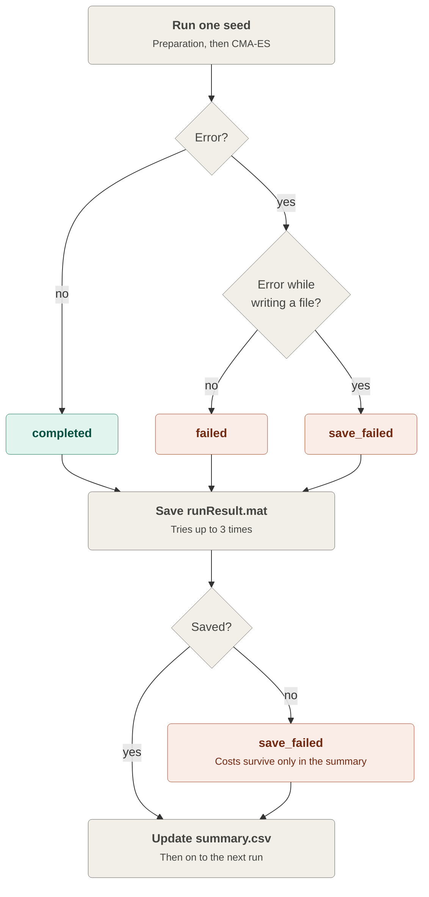
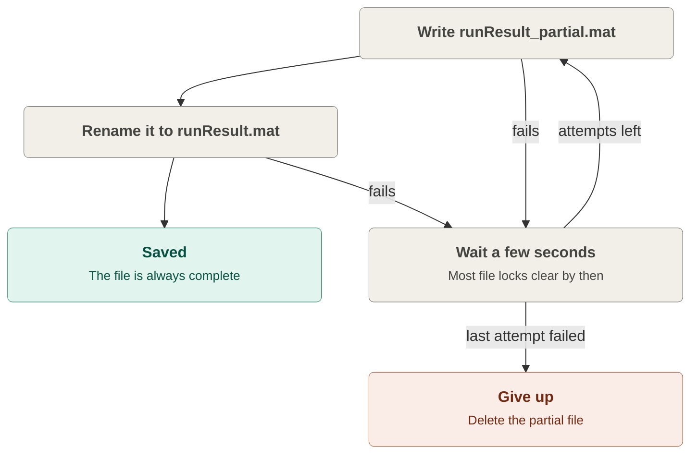
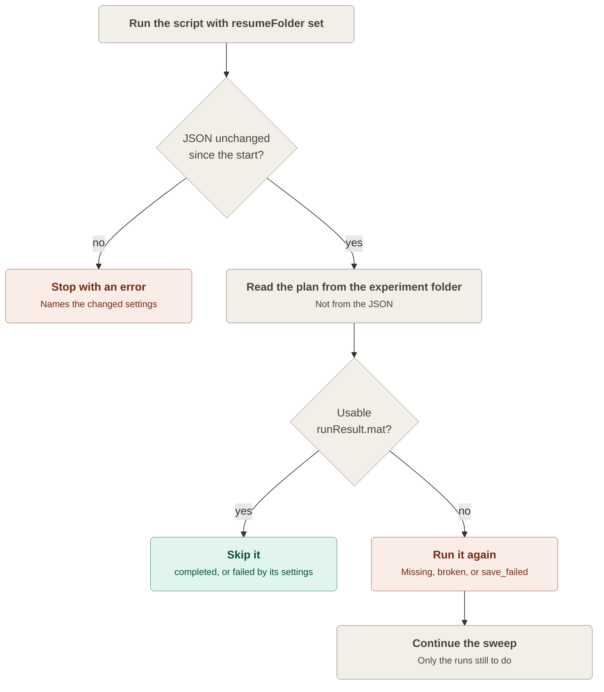

# Bookkeeping: saving results and surviving failures

The [Processing workflow](workflow.md) page describes the two loops that do the science. This page covers everything around them: how results are saved, what can go wrong during a sweep, and what the sweep does about each problem. Read it when you want to understand a row in `summary.csv` that is not `completed`, or when you need to continue a sweep that stopped.

## Why so many things can go wrong

One optimization run takes minutes. A sweep is many runs one after the other: every combination of settings, each repeated with several seeds. A sweep can easily run all night with nobody watching. A long, unattended job meets problems that a single short run would almost never see:

- **Some settings simply don't work.** An extreme tolerance can make input preparation fail, or a cost model can hit a case it cannot handle.
- **Windows sometimes blocks files for a moment.** Antivirus, the search indexer, or OneDrive may open a file just as MATLAB tries to write it. A full disk or a dropped network drive has the same effect.
- **You may have a file open.** It is natural to open `summary.csv` in Excel to check progress, and Excel then locks the file.
- **The machine can stop.** Windows restarts for an update, MATLAB crashes, or someone presses Ctrl+C.

Without any protection, any one of these would end the whole sweep, and every run after it would be lost. The bookkeeping code is there to keep three promises:

1. **Finished work is never lost.** Each run is saved the moment it ends.
2. **One problem doesn't stop the sweep.** A failing run is recorded, and the sweep moves on to the next one.
3. **A stopped sweep can continue.** You restart it, and it runs only what is still missing.

## The safety net: one result file and one summary row per run

Every planned run ends with two things, whether it worked or not:

- its own result file, `runs/<combinationId>/seed_<n>/runResult.mat`;
- a row in `summary.csv` (and `summary.mat`), with a **status** and, if something went wrong, the error message.

When the sweep starts, every row is `pending`. After each run, its row is filled in and the summary file is written again. So at any moment, `summary.csv` shows what is done, what failed, and what is still waiting.

## What can go wrong, and what the sweep does

| What goes wrong | Example | What the sweep does |
| --- | --- | --- |
| **Preparation fails** for a combination | An extreme setting breaks the mesh–image intersection | Marks every seed of that combination as `failed`, then moves on to the next combination |
| **The optimization fails** for one seed | The cost model or CMA-ES throws an error | Marks this seed as `failed` and continues with the next seed |
| **A file can't be written** during a run | CMA-ES can't write its own log file because the disk is full | Marks this seed as `save_failed` and continues |
| **`runResult.mat` can't be saved** | Antivirus keeps the new file locked | Tries again a few times. If that still fails, marks the run as `save_failed`. The costs stay in the summary. |
| **`summary.csv` can't be written** | The file is open in Excel | Prints a warning and carries on. The next run writes the summary again. |
| **Something unexpected happens** | A bug in the bookkeeping itself | Writes the full error into `experiment_log.txt` and stops. Everything saved so far is safe, so you can resume. |
| **The machine stops** | Windows restart, crash, Ctrl+C | Nothing can catch this. Every finished run is already on disk, so you can resume. |

A failed or `save_failed` run is still saved like a normal run, with its error message. This way, later analysis can load every run the same way and filter on the status.

## How a run gets its status

There are only three final statuses. This diagram shows how one run ends up with one of them:

Colours: green means the run **worked**, coral means **something went wrong**, and gray boxes are **bookkeeping** steps.

### Why `failed` and `save_failed` are kept apart

The two statuses point to different causes, and they are treated differently when you resume:

- **`failed`: the problem is probably in the settings.** Running the same settings again would most likely give the same error, so a resumed sweep **does not** retry these runs.
- **`save_failed`: the problem was the computer, not the settings.** A locked file or a full disk is often fine an hour later, so a resumed sweep **does** run these again.

## Saving carefully

A result file is not written in one go. It is first written under a temporary name, and only renamed to `runResult.mat` once it is complete:

Two ideas are at work here:

- **Waiting and trying again** handles the short file locks from antivirus or sync clients, which usually last only seconds.
- **The temporary name** means a crash in the middle of writing can never leave a half-written file that looks like a finished result. The worst case is one missing file, and a resumed sweep simply runs that one again.

## When the sweep stops anyway: resuming

If the sweep stops (a crash, a restart, Ctrl+C, or an unexpected error), you don't start over. You point `experiment.resumeFolder` in the JSON to the experiment folder and run the script again. The steps are in [Running the project](running.md#resuming-a-stopped-sweep). This is what happens then:

- **The JSON check protects you from yourself.** When resuming, the settings come from the experiment folder, not from the JSON. If you had edited the JSON in the meantime, your edits would be silently ignored. So the sweep refuses to start until the JSON matches the copy saved at the start.
- **The summary is rebuilt from the result files.** MATLAB may have stopped after saving a run but before updating the summary. The result files are always the most up-to-date record, so the sweep trusts those.
- **A combination whose seeds are all finished is skipped completely,** including its slow input preparation.

## Things you may need to do yourself

- **Check the status column after a sweep.** The last line printed says how many runs completed, failed, and were `save_failed`. The `errorMessage` column in `summary.csv` says why.
- **Retry a `failed` run on purpose.** Resuming never retries these. If you fixed the cause (for example a bug in a cost model), delete that run's `runResult.mat` and resume. Note that changing a setting in the JSON is not allowed when resuming; start a new experiment instead.
- **Read `experiment_log.txt`** when a sweep stopped while you were away. It holds everything MATLAB printed, including the full error report.

## Where this lives in the code

You only need this when you want to change the bookkeeping.

| What | Where |
| --- | --- |
| The loops, the error handling, and the statuses | [`runBonePoseOptimizationExperiment.m`](../functions/bonePoseOptimization/runBonePoseOptimizationExperiment.m): `runAllCombinations` and `runOneSeed` |
| Saving with retries and a temporary file | [`saveMatFileWithRetry.m`](../functions/bonePoseOptimization/experimentStorage/saveMatFileWithRetry.m) |
| Deciding which runs to skip on resume | `fillSummaryFromSavedRuns` and `loadFinishedRunResult` in [`runBonePoseOptimizationExperiment.m`](../functions/bonePoseOptimization/runBonePoseOptimizationExperiment.m) |
| Checking the JSON against the saved copy | `checkResumeFolderMatchesConfig` in [`createBonePoseOptimizationExperimentConfig.m`](../functions/bonePoseOptimization/configuration/createBonePoseOptimizationExperimentConfig.m) |

## Where to look next

- To run or resume a sweep: [Running the project](running.md).
- To find out what each saved file contains: [Output structure](output-structure.md).
