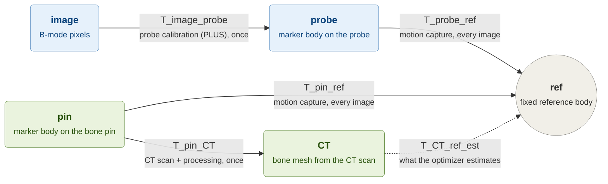
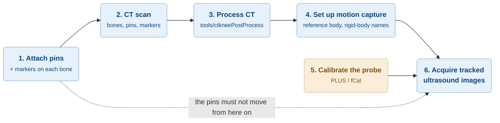

# Experiment setup

This page explains how to build the physical experiment that produces the input data for this project. It is written for someone who wants to repeat the experiment and does not yet know where to start.

The workflow was developed for a knee phantom. The same arrangement works with a cadaver leg.

## 1. What the experiment measures

The goal is to find **where a bone is**, using only tracked 2D ultrasound images and a CT model of that bone. In transform terms, we want `T_CT_ref`: the pose that places the CT bone mesh in the tracker reference frame `ref`.

The experiment gets this pose **twice**, along two independent paths:

- **Estimate path.** Each ultrasound image is placed in 3D with `T_image_ref = T_probe_ref * T_image_probe`. The optimizer then moves the CT mesh until it fits the bone seen in those images. Its result is `T_CT_ref_est`.
- **Ground-truth path.** A pin is screwed into the bone and tracked by the motion-capture system. Because the CT scan also shows the pin, the pin carries the CT mesh into `ref` directly: `T_CT_ref = T_pin_ref * inv(T_pin_CT)`. This answer is used only to check the estimate.

Every instrument in the setup exists to provide **one link** in these two chains:

Colours: blue boxes are the **estimate path**, green boxes are the **ground-truth path**, and the grey circle is the shared frame `ref`. Each arrow points from the source frame to the target frame, so `T_pin_CT` maps pin coordinates into CT coordinates. The dashed arrow is the unknown that the code solves for.

Keep the two paths apart in your mind. The optimizer receives only the estimate path: the CT mesh, the tracked image planes, the image intensities, and a coarse initial pose. The ground-truth pose is stored separately and is used only after estimation, for validation. This prevents the cost function from using the answer it is meant to find.

## 2. The instruments and what each one provides

| Instrument | What it gives you | Link in the chain | When | What breaks if it goes wrong |
| --- | --- | --- | --- | --- |
| Bone pin with optical markers | A trackable rigid body fixed to each bone | `T_pin_ref` (with motion capture) | Attached before the CT scan, kept until the end | The pin moves after the CT scan, and the ground truth is no longer valid |
| Fixed reference body | The common frame `ref` that all poses are expressed in | Defines `ref` | Every image | The reference moves during acquisition, and images and pins drift apart |
| CT scan and CT processing | Bone meshes, anatomical bone frames, and the pin frame in CT coordinates | `T_pin_CT`, `T_bone_CT` | Once, before the ultrasound experiment | Wrong marker order or axes, so the CT pin frame doesn't match the tracked one |
| Optical motion capture (Qualisys) | Poses of the probe, reference, and pins | `T_probe_ref`, `T_pin_ref` | Every image | Rigid-body names, axes, units, or handedness differ from the CT side |
| Probe marker body and probe calibration (PLUS / fCal) | The position of each ultrasound pixel relative to the probe markers | `T_image_probe` | Once, before acquisition | Every image plane is offset in 3D, and the estimate is biased |
| Acquisition software ([BmodeMocapIntegration](https://github.com/dacvm/BmodeMocapIntegration)) | Ultrasound images saved together with their tracking data | Pairs each image with its poses | During acquisition | Images are paired with the wrong poses |

## 3. The order of the work

Colours: blue steps must happen **in this order**. The orange step, probe calibration, doesn't depend on the specimen, so you can do it at any time before acquisition.

The rest of this page describes each step with the same five headings: **Goal**, **You need**, **Do**, **You get**, and **Pitfalls**.

## 4. Steps

### 4.1. Attach the bone pins

- **Goal:** make each bone trackable, so the ground-truth path exists.
- **You need:** one bone pin per bone you want to register (for example the femur and the tibia), each with four optical markers, plus one fixed reference body for the workspace.
- **Do:** fix each pin rigidly into its bone and mount the four markers on it. Place the reference body somewhere it stays still for the whole experiment.
- **You get:** a specimen whose bones can each be seen by the motion-capture system.
- **Pitfalls:** the marker numbering defines the pin frame. Marker 1 is the origin, marker 2 sets the X axis, marker 3 sets the Y axis, and marker 4 is kept for checks. Write the numbering down now, because the CT processing and the motion-capture software must both use it. See [Knee Phantom Processing](../tools/ctkneePostProcess/README.md#rigid-body-definition-and-motion-capture).

### 4.2. CT-scan the specimen

- **Goal:** get the bone shape and the pin position in the same coordinates (`CT`).
- **You need:** the specimen with pins and markers attached, and access to a CT scanner.
- **Do:** scan the complete setup: bones, pins, and markers. Export a surface mesh (STL) for each bone and for each marker sphere.
- **You get:** bone STL files, marker STL files, and the CT volume for defining anatomical frames.
- **Pitfalls:** do the CT scan **before** the ultrasound experiment, and never re-attach or move a pin after it. The ground truth depends on the pin staying exactly where the CT saw it.

### 4.3. Process the CT data

- **Goal:** turn the CT exports into `T_pin_CT` (pin frame in CT) and `T_bone_CT` (anatomical bone frame in CT).
- **You need:** the bone and marker STL files, and a MAT file with the anatomical coordinate systems (see `functions/external/ERCkneeFrames/`).
- **Do:** run the [Knee Phantom Processing tool](../tools/ctkneePostProcess/README.md). It fits a sphere to each marker, builds each pin frame from the marker centres, and loads the bone meshes and anatomical frames.
- **You get:** a MAT file with `bones` and `bonepins`. This is the `ctPostProcessedMatFile` described in [Input data](input-data.md).
- **Pitfalls:** check the saved figure. The pin axes should sit on the marker spheres and follow the numbering you wrote down in step 4.1.

### 4.4. Set up the motion-capture workspace

- **Goal:** let the motion-capture system measure `T_probe_ref` and `T_pin_ref`.
- **You need:** an optical motion-capture system (this project uses Qualisys) and the specimen under its working volume.
- **Do:** define rigid bodies for the reference, each pin, and the probe. Use the same marker order and axes as in the CT processing. Confirm that all rigid bodies are visible at the same time from where you will hold the probe.
- **You get:** a system that streams the pose of every rigid body.
- **Pitfalls:** a mismatch in marker order, axis direction, units, or handedness gives a registration that *looks* plausible but is wrong. Check these before collecting any data.

### 4.5. Calibrate the ultrasound probe

- **Goal:** get `T_image_probe`, which places each ultrasound pixel relative to the probe markers.
- **You need:** the B-mode probe with its marker body attached, and the [PLUS Toolkit](https://plustoolkit.github.io/) (fCal).
- **Do:** run a PLUS probe calibration with the marker body mounted exactly as it will be during acquisition.
- **You get:** an fCal/PLUS XML file with exactly one `ImageToProbe` transform. It also holds the pixel spacing.
- **Pitfalls:** if the marker body on the probe is moved after calibration, the calibration must be repeated.

### 4.6. Acquire tracked ultrasound images

- **Goal:** collect ultrasound images of the bone surface, each with the poses needed to place it in `ref`.
- **You need:** everything above running together, plus the acquisition software from the [BmodeMocapIntegration repository](https://github.com/dacvm/BmodeMocapIntegration).
- **Do:** move the tracked probe over the bone surface and record images. Group the recordings in folders whose names contain `femur` or `tibia`.
- **You get:** pairs of files per recording. A Plus sequence file (`.mha`) holds the images with probe and reference poses, and a Qualisys CSV holds the reference and pin poses. See [Ultrasound Spatial Processing](../tools/ultrasoundSpatialProcessing/README.md#required-input-data) for the expected folder layout.
- **Pitfalls:** check that the reference body and the pin stayed visible during each recording. Images without valid tracking are dropped later.

## 5. Checklist before you acquire

- [ ] Each pin is still in the exact position it had during the CT scan.
- [ ] The reference body is fixed and won't move during acquisition.
- [ ] Marker numbering, rigid-body names, axes, and handedness match between CT processing and motion capture.
- [ ] Units agree between CT, motion capture, and calibration.
- [ ] The probe calibration was done with the marker body in its current position.
- [ ] The reference, pins, and probe are all visible at once from your probe positions.

## 6. What happens next

The recordings and the CT result are not used by the optimizer directly. The tools in [`tools/`](../tools/README.md) first turn them into the MAT files the optimizer reads: image planes in `ref`, ground-truth poses, extracted bone surfaces, and a coarse initial pose. [Input data](input-data.md) describes those files, and [Workflow](workflow.md) shows how a run uses them.
