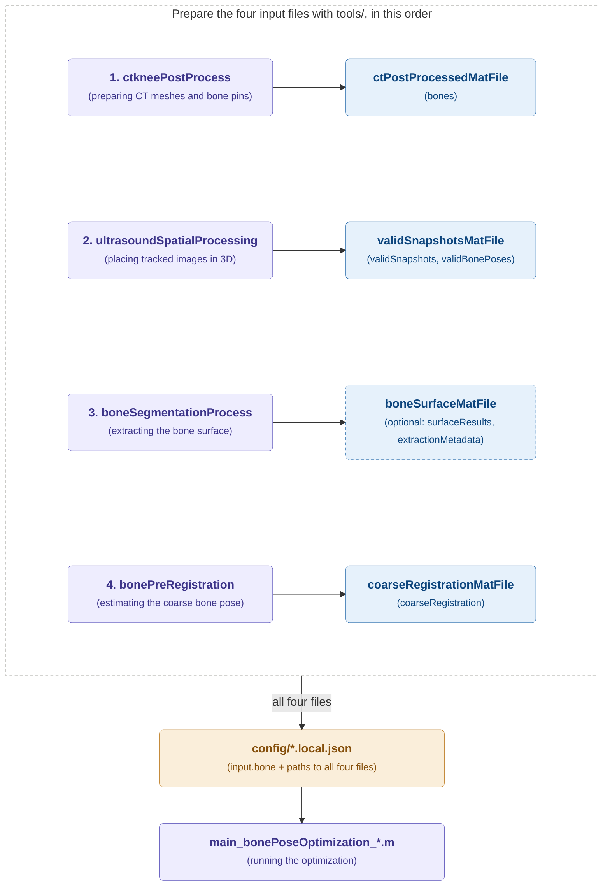
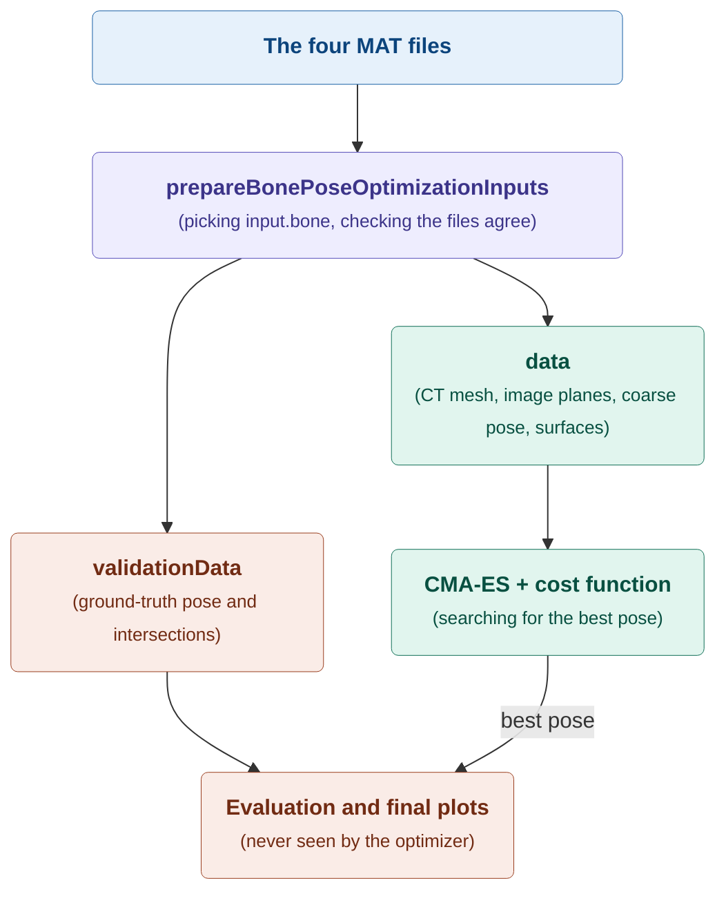

# Required input data

Raw B-mode ultrasound and motion-capture data can be recorded with the acquisition software in [BmodeMocapIntegration](https://github.com/dacvm/BmodeMocapIntegration). Before running the optimizer, follow the instructions in [`tools/README.md`](../tools/README.md) and the README inside each relevant tool directory.

This page explains what the `main_bonePoseOptimization_*.m` scripts need before they can run: the MAT files made by the tools, the local JSON file that points to them, and what each MAT file must contain.

## 1. What you need before you run

Colours: purple boxes are **code you run**, blue boxes are **MAT files**, and the orange box is the **config file you edit**. A dashed border means the file is **optional**.

Run the tools in the numbered order, because each tool also reads files made by the tools before it. For example, `bonePreRegistration` reads both the CT file and the bone-surface file.

The main scripts never look for these files themselves. They only read the local JSON file, and the JSON file holds the path to each MAT file. So all four files must exist and be listed in the JSON, not only the last one.

| Configuration field | Made by | High-level purpose |
| --- | --- | --- |
| `ctPostProcessedMatFile` | `ctkneePostProcess` | The CT bone meshes, anatomical coordinate systems, and the rigid relationship between each bone and its selected pin. |
| `validSnapshotsMatFile` | `ultrasoundSpatialProcessing` | The accepted, tracked B-mode image planes, plus separate ground-truth bone poses and intersections. The optimizer uses the image planes; the ground truth is kept apart for validation (see [section 4](#4-where-the-data-goes)). |
| `boneSurfaceMatFile` | `boneSegmentationProcess` | *Optional.* The 2D and 3D bone-surface points found in each ultrasound image. Only needed when the cost model's definition sets `requiresBoneSurface` to `true`: `ICPLike`, `intensityICP`, `PIMLOP`, and `intensityPIMLOP`. `intensityLine` does not need it. |
| `coarseRegistrationMatFile` | `bonePreRegistration` | The approximate CT-to-reference transform that starts the optimizer, and the matching coarse bone mesh in the reference frame. |

The four files must describe the same specimen, bone, pin selection, marker geometry, units, and coordinate-frame conventions. [Section 3.1](#31-checks-that-the-files-belong-together) lists how this is checked.

## 2. The local configuration file

Each main script reads exactly one JSON file. This is its only input:

| Script | Reads |
| --- | --- |
| `main_bonePoseOptimization_oneSweep.m` | `config/oneSweep.local.json` |
| `main_bonePoseOptimization_hyperparamSweep.m` | `config/hyperparamSweep.local.json` |

These local files are git-ignored copies of the templates in `config/`. A script stops with a "Local config not found" error until you make the copy. [Running the project](running.md#2-configure-the-input-paths-and-settings) shows how.

**How paths are resolved.** `project.root` is resolved relative to the folder of the JSON file; the templates use `".."`, which is the repository root. All other paths in the JSON (the MAT files, `outputFolder`, `resumeFolder`) are then resolved relative to `project.root`, not to MATLAB's current folder. Absolute paths also work.

The JSON has these blocks. A block is a top-level key, and its fields sit one level below it. All fields are required unless the table says otherwise.

| Block | Field | Meaning |
| --- | --- | --- |
| `schemaVersion` | | Must be `4`. Older configurations are not supported. |
| `project` | `root` | The repository root, relative to the JSON file. |
| | `functionsFolderName` | The folder that holds the project functions, normally `"functions"`. |
| `input` | `bone` | One bone code, such as `"F"` for femur or `"T"` for tibia. It picks the matching record from every MAT file. |
| | `validSnapshotsMatFile` | Path to the snapshots MAT file. |
| | `boneSurfaceMatFile` | *Optional.* Path to the bone-surface MAT file. Leave it out or set it to `""` when the cost model does not need it. |
| | `ctPostProcessedMatFile` | Path to the CT MAT file. |
| | `coarseRegistrationMatFile` | Path to the coarse-registration MAT file. |
| `intersection` | `normalFacingToleranceDeg` | How far a mesh face may turn away from the probe and still count as visible, in degrees. Can be a list of values to sweep. |
| `cost` | `model` | The cost model name, for example `"PIMLOP"`. See [Supported cost functions](cost-functions.md). |
| | `fixedParameters` | Cost settings with one value, shared by all runs. |
| | `hyperparameters` | Cost settings to sweep. Each one is a list of candidate values. |
| `logging` | `printPreparationProgress` | `true` prints a short summary after input preparation. |
| | `printEvaluationProgress` | `true` prints progress during cost evaluations. Keep it `false` for long sweeps. |
| `optimizer` | *all settings* | *Optional.* The CMA-ES settings in [section 5](#5-optimizer-parameters). A missing setting gets its default. |
| `experiment` | `name` | Name of the experiment, used in the output folder name. Only letters, numbers, `_`, and `-`, and it must start with a letter or number. |
| | `seeds` | List of distinct positive integer seeds. Every combination is run once per seed. |
| | `outputFolder` | Where results are written. |
| | `resumeFolder` | *Optional, sweep only.* An experiment folder to continue. Keep it `""` for a new experiment. See [Running the project](running.md#51-resuming-a-stopped-sweep). |

A one-sweep JSON must give exactly one value in every list (`normalFacingToleranceDeg`, each hyperparameter, and `seeds`). Otherwise the one-sweep script stops, because the file is really a sweep.

## 3. What the MAT files must contain

`prepareBonePoseOptimizationInputs` loads only the variables listed below. A missing variable or field stops the run with an error that names it.

| File | Variable | Required content |
| --- | --- | --- |
| `ctPostProcessedMatFile` | `bones` | Struct array with one record per bone. Each record has `bone` (the bone code), `name`, `mesh` (a `triangulation` in CT coordinates), and `T_bone_CT` (4x4). |
| `validSnapshotsMatFile` | `validSnapshots` | Struct array of snapshot groups. Each group has `bone`, `name`, `path`, and `data`. Each `data` record has `plane`, `intersection` (ground truth), and `sourceIndex`. |
| | `validSnapshots(...).data(...).plane` | `T_image_ref` (4x4), `p0`, `ex`, `ey`, `n` (3x1 each), `W`, `H` (physical size), `nRows`, `nCols`, `image` (stored as `nCols`-by-`nRows`), and `timestamp`. |
| | `validBonePoses` | Has `bonePoses`, one record per bone with `bone`, `meshCT` (a `triangulation` in CT coordinates), and `data`. `data` must be **one** pose with `T_CT_ref` and `T_bone_ref`; a pose series (one pose per image) is not supported yet. Older files that store the transformed mesh as `data.mesh` instead of `meshCT` still load. |
| `boneSurfaceMatFile` | `surfaceResults` | Struct array of groups with `bone`, `name`, `path`, and `data`. Each `data` record has `sourceIndex`, `status` (`"extracted"`, `"noSurface"`, or `"skippedUnprocessed"`), `surfaceCoordinatesXY` (N-by-2), and `surfaceCoordinatesXYZRef` (N-by-3). Optional normals: `surfaceNormalXY` (N-by-2) and `surfaceNormalMask` (N-by-1 logical), always together. |
| | `extractionMetadata` | `sourceUltrasoundFile` and `sourceUltrasoundVariable` (which snapshots file the surfaces came from), plus `coordinateConvention`, `beamAxis`, and `beamDirection`. |
| `coarseRegistrationMatFile` | `coarseRegistration` | Struct array with one record per bone. Each record has `bone`, `status` (must be `"registered"`), `T_CT_ref_est` (4x4), `T_bone_ref_est` (4x4), and `boneMeshRef_est` (a `triangulation` in the reference frame). |

### 3.1. Checks that the files belong together

The files come from different tools, so a mix-up is easy: an old segmentation, the wrong bone, or a file from another session. Input preparation checks the following before the optimizer starts. If one fails, the error message says which.

- **One record per bone.** `bones`, `coarseRegistration`, and `validBonePoses.bonePoses` must each have exactly one record for `input.bone`, and the snapshots must have at least one image of that bone. Records are matched by bone code, never by their position in the array.
- **Proper rigid transforms.** Every 4x4 transform must be finite, with an orthonormal, right-handed rotation and `[0 0 0 1]` as its last row.
- **The coarse pose used the same CT model.** `T_bone_ref_est` must equal `T_CT_ref_est * T_bone_CT`, and `boneMeshRef_est` must equal the CT mesh moved by `T_CT_ref_est`, with the same connectivity.
- **The ground truth used the same CT model.** `T_bone_ref` must equal `T_CT_ref * T_bone_CT`.
- **Every image plane is consistent.** `T_image_ref` must equal `[ex ey n p0; 0 0 0 1]`, and the image size must match `nCols` and `nRows`.
- **The surfaces come from the same snapshots.** `extractionMetadata.sourceUltrasoundFile` must point to the configured `validSnapshotsMatFile`, with `sourceUltrasoundVariable` equal to `"validSnapshots"`. There must be exactly one surface measurement per snapshot. They are matched by group name, group path, and `sourceIndex`.
- **The surfaces use the expected image coordinates.** Points are one-based `[x, y] = [column, row]`, measured from the centre of the top-left pixel, and the ultrasound beam runs along increasing row index.

## 4. Where the data goes

Input preparation splits the loaded data in two. Everything that helps to **estimate** the pose goes into `data`, which the optimizer uses. Everything that is the **answer** goes into `validationData`, which only the evaluation and the final plots receive.

Colours: green is what the **optimizer may use**, coral is the **ground truth** it must never see, and purple is **code**.

This split is why the snapshots file can hold the ground truth next to the images. The ground truth is only ever compared with the result, so the cost function cannot use the answer it is trying to find.

## 5. Optimizer parameters

The optimizer represents a candidate as a local six-value perturbation `[vx; vy; vz; wx; wy; wz]` around the coarse CT-to-reference transform. Translation is expressed in the mesh length unit, normally millimetres, and rotation is configured in degrees before conversion to radians.

The `optimizer` block is optional. A setting that is missing gets the default below. The templates set every value explicitly.

| Setting | Default | Meaning |
| --- | --- | --- |
| `translationBoundMm` | 10 | Symmetric translation limit for each of the three translation components. |
| `rotationBoundDeg` | 10 | Symmetric rotation-vector limit for each of the three rotation components. |
| `translationSigmaMm` | 5 | Initial CMA-ES search spread for the translation components. |
| `rotationSigmaDeg` | 5 | Initial CMA-ES search spread for the rotation components. |
| `populationSize` | 12 | Number of CMA-ES candidate solutions evaluated in a population. |
| `maxFunctionEvaluations` | 400 | Function-evaluation budget for each optimization run. |
| `useParfor` | `true` | Requests parallel candidate evaluation when the Parallel Computing Toolbox and a valid license are available. |
| `parforWorkers` | 4 | Worker limit passed to the bundled parallel CMA-ES implementation. |

Every optimizer setting is one positive number (`useParfor` is `true` or `false`), shared by all runs of an experiment. Bounds and sigmas may be fractional; `populationSize`, `maxFunctionEvaluations`, and `parforWorkers` must be integers.

## 6. Optimization code organization

The three stable workflow entry points remain directly under
`functions/bonePoseOptimization/`: cost evaluation, one optimization run, and
one experiment run. Supporting functions are grouped one level below:

- `configuration/` reads JSON and builds experiment and scalar run settings.
- `costModels/` contains model registration, cost functions, and validators. Its `legacy/` subfolder keeps retired models for reference only; active code does not use them.
- `inputPreparation/` loads and prepares reusable optimization inputs.
- `poseEvaluation/` converts optimizer states and evaluates candidate-pose geometry.
- `evaluationMetric/` and `evaluationPlot/` analyze saved results.
- `tests/` test codes that verifies the active pipeline.
