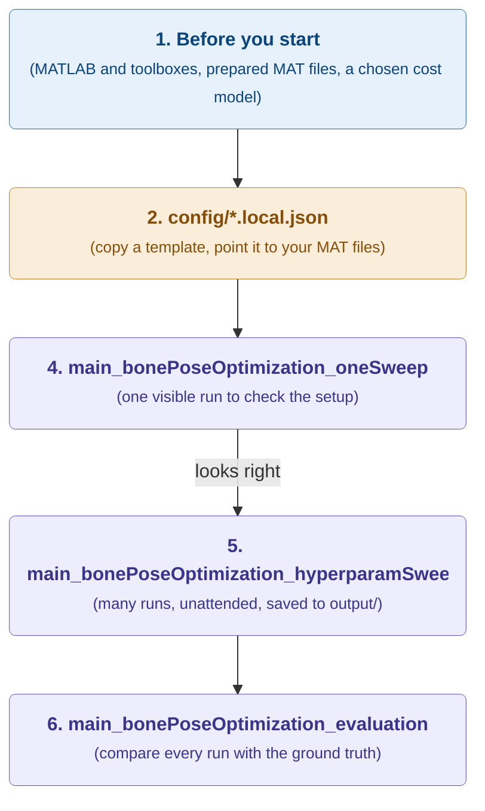

# Running the project

This page takes you from a fresh copy of the repository to a finished, evaluated experiment. It is written for someone who wants to use the framework on their own data, or repeat the experiment it was built for.

Running the optimizer is the **last** step of a longer chain. The scripts need prepared input files and a configuration that points to them, and they stop with an error if either is missing. So read [section 1](#1-before-you-start) first, even if you only want to try one run.

## The path at a glance



Colours: purple boxes are **scripts you run**, the orange box is the **config file you edit**, and the blue box is the **preparation** you do once.

The three scripts have different jobs:

| Script | What it is for | What it leaves behind |
| --- | --- | --- |
| `main_bonePoseOptimization_oneSweep.m` | One optimization with one setting and one seed, with figures before and after. Use it to check a setup, debug, or demonstrate the method. | Results in the MATLAB workspace and raw CMA-ES files on disk. |
| `main_bonePoseOptimization_hyperparamSweep.m` | Many optimizations over a grid of settings and seeds, without figures. Use it for actual experiments. | One experiment folder under `output/` with every run saved. |
| `main_bonePoseOptimization_evaluation.m` | Scores a finished sweep against the ground truth and ranks the settings. | Tables in the experiment folder and figures on screen. |

## 1. Before you start

### 1.1. Requirements

- MATLAB R2024b with support for `triangulation`, tables, JSON decoding, and the functions used by the preparation tools.
- Prepared input MAT files from the workflows under `tools/` (see [section 1.2](#12-prepare-the-input-data)).

Select these MATLAB toolboxes when installing MATLAB:

| Toolbox | Needed for | Used by |
|---|---|---|
| Statistics and Machine Learning Toolbox | Required. `knnsearch` in the ICP-like cost function. | `main_bonePoseOptimization_*.m`, `cost_ICPLike.m` |
| Parallel Computing Toolbox | Optional but recommended. Parallel CMA-ES candidate evaluation (`parfor`). Without it, a configuration requesting `useParfor` falls back to serial CMA-ES with a warning, which is much slower. | `runBonePoseOptimization.m`, `functions/external/CMAES/cmaes_parfor.m` |
| Image Processing Toolbox | Bone segmentation and surface extraction (`strel`, `imfill`, `imgaussfilt`, `bwperim`, `bwconncomp`, ...). | `tools/boneSegmentationProcess/`, `createBoneSurfaceReviewGUI.m` |
| Optimization Toolbox | `quadprog` and `optimoptions` for regularizing bone surface segments. | `tools/boneSegmentationProcess/` |
| Computer Vision Toolbox | `pointCloud`, `pcregistericp`, `rigidtform3d`, `pcfitsphere`. | `tools/bonePreRegistration/`, `tools/ctkneePostProcess/` |
| Robotics System Toolbox | `quat2rotm`, `quaternion`, `meanrot` for Qualisys tracking data and pose averaging. Navigation, UAV or Aerospace Toolbox also provide these functions, so one of them is enough. | `functions/qualisys_related/`, `tools/ultrasoundSpatialProcessing/` |

Running only the `main_bonePoseOptimization_*.m` scripts needs just the first two toolboxes. The remaining four are for the preprocessing tools under `tools/`. No other toolboxes are needed.

The external CMA-ES implementation used by this project is already stored under `functions/external/`. Do not modify files in that directory when changing project-specific optimization behavior.

### 1.2. Prepare the input data

The optimizer does not read raw recordings. It reads four MAT files that the tools in [`tools/`](../tools/README.md) make from your CT scan and tracked ultrasound recordings. Making them is most of the work, and it is done once per specimen.

1. **If you collect your own data**, read [Experiment setup](experiment-setup.md) first. It explains the bone pins, CT scan, motion capture, probe calibration, and acquisition, and the checklist there prevents mistakes that no later step can fix.
2. **Read [Required input data](input-data.md).** It shows which tool makes which file, in which order to run the tools, and what each file must contain. It also lists the checks that stop a run when the files do not belong together.
3. **Run the tools** in the order given there. Each tool has its own README with setup and usage.

You are ready for the next step when you have these files for one specimen:

- [ ] `ctPostProcessedMatFile` from `ctkneePostProcess`.
- [ ] `validSnapshotsMatFile` from `ultrasoundSpatialProcessing`.
- [ ] `boneSurfaceMatFile` from `boneSegmentationProcess`, if your cost model needs it (see [section 1.3](#13-choose-a-cost-model)).
- [ ] `coarseRegistrationMatFile` from `bonePreRegistration`.

### 1.3. Choose a cost model

The cost model decides how a candidate bone pose is compared with the ultrasound images. Each one has its own config template, its own parameters, and its own input needs. [Supported cost functions](cost-functions.md) describes them all. Two practical points for choosing:

- `intensityLine` uses only the images, so it does not need `boneSurfaceMatFile`. The other models (`ICPLike`, `intensityICP`, `PIMLOP`, `intensityPIMLOP`) do.
- The parameters you want to sweep for a model are its `hyperparameters`. The sweep templates in [section 2.3](#23-switching-cost-model) already pick sensible ones.

## 2. Configure the input paths and settings

### 2.1. Templates and local copies

The files in `config/` are **templates**. They are tracked by git and hold a complete, working set of settings for each cost model. The main scripts do not read them directly. Each script reads a **local copy** whose name ends in `.local.json`. Git ignores local copies, so you can edit them freely without changing tracked files.

| Script | Reads |
|---|---|
| `main_bonePoseOptimization_oneSweep.m` | `config/oneSweep.local.json` |
| `main_bonePoseOptimization_hyperparamSweep.m` | `config/hyperparamSweep.local.json` |

### 2.2. First-time setup

**Copy a template.** Copy one template to each script's local file. A script stops with a "Local config not found" error until you do this.

```matlab
copyfile('config/optconfig_oneSweep_PIMLOP.json',               'config/oneSweep.local.json')
copyfile('config/optconfig_hyperparamSweep_intensityLine.json', 'config/hyperparamSweep.local.json')
```

**Point it to your data.** The templates contain the input paths and bone of the original experiment, which you will not have. Open each local copy and set at least:

- `input.bone`: the bone you want to register, for example `"T"` for tibia.
- The four paths in `input`: your MAT files from [section 1.2](#12-prepare-the-input-data). Leave `boneSurfaceMatFile` as `""` when your cost model does not need it.
- `experiment.name`: a name that tells you later what this experiment was.

Relative paths are resolved from the repository root, not from MATLAB's current folder. Every block and field of the JSON, and the optimizer settings, are explained in [Required input data](input-data.md#2-the-local-configuration-file).

**Check the optimizer budget.** The one-sweep templates use a small population and evaluation budget so that a check finishes quickly. Raise `optimizer.populationSize` and `optimizer.maxFunctionEvaluations` once you trust the setup, and set `optimizer.parforWorkers` to what your machine can run.

### 2.3. Switching cost model

Copy a different template over the local file. You never need to edit the script. Remember to set your input paths again afterwards (see [section 2.2](#22-first-time-setup)). Available templates:

- `config/optconfig_oneSweep_intensityLine.json`: smoothed-intensity interactive run.
- `config/optconfig_oneSweep_ICPLike.json`: ICP-like point-cloud interactive run.
- `config/optconfig_oneSweep_intensityICP.json`: combined intensity and 3D-distance interactive run.
- `config/optconfig_oneSweep_PIMLOP.json`: P-IMLOP interactive run.
- `config/optconfig_oneSweep_intensityPIMLOP.json`: combined intensity and P-IMLOP interactive run.
- `config/optconfig_hyperparamSweep_intensityLine.json`: unattended smoothed-intensity sweep over `intensitySmoothingSigmaMm`.
- `config/optconfig_hyperparamSweep_intensityICP.json`: unattended combined sweep over `intensitySmoothingSigmaMm` and `weight`.
- `config/optconfig_hyperparamSweep_PIMLOP.json`: unattended P-IMLOP sweep over `kappa`.
- `config/optconfig_hyperparamSweep_intensityPIMLOP.json`: unattended combined sweep over `kappa` and `weight`.

Files under `config/legacy/` are retired configurations kept for reference only. The current code does not support them.

### 2.4. When to change a template

Edit and commit a template only when its content should change for everyone, for example when a cost model gains a new parameter or when better default values are found. Day-to-day changes such as other input files or a quick parameter try belong in your local copy. Every experiment saves the configuration it used as `experiment_config_snapshot.json` (see [Output structure](output-structure.md)), so git does not need to record each run's settings.

The tests read the templates, not your local copies, so local edits never change test results.

## 3. Start MATLAB in the repository root

Both main scripts build the configuration path from `pwd`. Change MATLAB's current folder to the repository root (the folder containing `README.md`) before running any script:

```matlab
cd('D:/path/to/bmodeimage_3dspace')
```

The scripts add `functions/` to the MATLAB path themselves, so no other setup is needed.

## 4. Run one sweep first

```matlab
main_bonePoseOptimization_oneSweep
```

The one-sweep workflow requires exactly one hyperparameter combination and one seed. It displays the initial setup and intersections, runs CMA-ES, leaves the numeric result in the MATLAB workspace, and displays the optimized estimate alongside the separately stored validation data.

Always do this before a sweep. A sweep can run for hours without figures, so a wrong file or a wrong frame would only show up at the end. One visible run shows it in minutes. Use it to confirm that:

- The intended bone and input files are selected.
- Ultrasound planes and the coarse CT mesh share the correct reference frame.
- Probe-facing intersection pixels appear in plausible image locations.
- The initial and optimized costs are finite.
- Search bounds, population size, evaluation budget, and parallel settings are practical.

If input preparation stops with an error, the message names the file, variable, or check that failed. [Required input data](input-data.md#31-checks-that-the-files-belong-together) explains each check. The results stay in the workspace; what goes to disk is described in [Output structure](output-structure.md#8-one-sweep-output).

## 5. Run the hyperparameter sweep

```matlab
main_bonePoseOptimization_hyperparamSweep
```

A sweep runs every combination of the values listed in the local JSON (`normalFacingToleranceDeg` and each entry in `cost.hyperparameters`) once for every seed in `experiment.seeds`. One combination with one seed is one **run**. Start from the same input paths and optimizer settings you checked in [section 4](#4-run-one-sweep-first).

The sweep creates a new timestamped experiment on every invocation, unless `experiment.resumeFolder` is set (see below). Before starting, MATLAB prints the number of combinations, seeds, planned runs, and maximum planned CMA-ES function evaluations. Check these numbers: the run count grows with every value you add, and so does the time. During execution, each completed or failed run is written to disk and the summary files are refreshed. Set `logging.printEvaluationProgress` to `false` for long sweeps to keep the Command Window readable.

When it finishes, open `summary.csv` in the experiment folder. [Output structure](output-structure.md) explains every file, and [Bookkeeping](bookkeeping.md) explains a run status other than `completed`.

### 5.1. Resuming a stopped sweep

If a sweep stops before it finishes (crash, Windows restart, Ctrl+C), it can be continued in the same experiment folder instead of starting over:

1. Leave every setting in the local JSON exactly as it was when the sweep started.
2. Set `experiment.resumeFolder` to the experiment folder, for example `"output/bonePoseOptimization/experiments/<name>_<timestamp>"`. Relative paths are resolved from the project root.
3. Run `main_bonePoseOptimization_hyperparamSweep` again.

The runner then takes the experiment specification and plan from `experiment_plan.mat` in that folder, not from the JSON. Runs with a `runResult.mat` that loads are skipped; runs whose file is missing or corrupt, and runs marked `save_failed` or stopped by a `MATLAB:save:*` error (also in older sweeps that stored them as `failed`), are run again. Other `failed` runs are kept, because their errors usually come from the settings. If the JSON differs from the folder's `experiment_config_snapshot.json` (ignoring `resumeFolder` itself), the script stops and names the changed fields, so edited settings are never silently ignored. Set `resumeFolder` back to `""` before starting a new experiment.

## 6. Evaluate a finished sweep

```matlab
main_bonePoseOptimization_evaluation
```

The evaluation compares every completed run with the ground truth and ranks the parameter combinations. The settings sit at the top of the script, not in a JSON file:

- `experimentFolderName`: the name of the experiment folder to evaluate, for example `intensityLine_20261009_165543_181`. The script looks for it under `output/bonePoseOptimization/experiments/`.
- `topCombinationCount`: how many of the best combinations the seed-distribution plot shows, so the plot stays readable for a large sweep.
- `heatmapSettings`: how the paneled heatmap figure is arranged (see below).

The script needs the experiment's `experiment_plan.mat`, `summary.mat`, and `validation_context.mat`. The plan must be schema version 4 and contain `parameterNames`, the list that says which summary columns are swept parameters and in which order. Older experiment plans without this list are not guessed from the table; inspect them with the code version that created them.

The tables are written to an `evaluation/` folder inside the experiment folder. [Output structure](output-structure.md#7-evaluation-output) describes them.

### 6.1. Arranging the heatmaps

`heatmapSettings` controls one figure made of small heatmaps. `xParameter` and `yParameter` form the cells inside each heatmap. `panelRowParameter` and `panelColumnParameter` spread the remaining parameter values over rows and columns of heatmaps; leave them `''` when they are not needed. When the figure should show only one slice, give a parameter a single value in `parametersToHold` instead. This changes only the figure, not the optimization results.

Every swept parameter must have exactly one of these roles. This way a new cost-model parameter can never be hidden from the figure by accident. To look at a second arrangement, copy the settings block under a new name and call `plotHyperparameterPaneledHeatmaps` again.

## 7. Where to look next

- To understand what happens inside a run: [Processing workflow](workflow.md).
- To understand what a sweep saves and why: [Bookkeeping](bookkeeping.md).
- To try your own idea of comparing a pose with the images: [Adding a new cost function](adding-a-cost-function.md).
