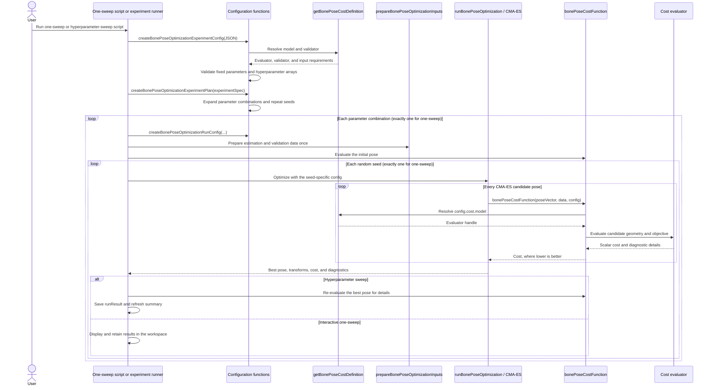

# Processing workflow

The one-sweep and hyperparameter-sweep scripts share the same configuration, planning, input-preparation, optimizer, and cost-dispatch framework. The sweep runner adds loops over parameter combinations and random seeds, plus immediate result saving. The following sequence shows the main function calls; display-only calls in the interactive one-sweep script are omitted.

At configuration time, `createBonePoseOptimizationExperimentConfig` asks the registry for the selected model's validator. The validator separates values that stay fixed from arrays that should be swept. `createBonePoseOptimizationExperimentPlan` then builds every combination, and `createBonePoseOptimizationRunConfig` merges one combination into `config.cost.parameters`, the scalar structure seen by a cost evaluator.

At optimization time, CMA-ES changes only the six-value local pose perturbation. `bonePoseCostFunction` is the stable public dispatcher: it reads `config.cost.model`, resolves the registered evaluator, and forwards the pose, prepared data, and scalar configuration. Consequently, the optimizer and runner do not need model-specific branches.
