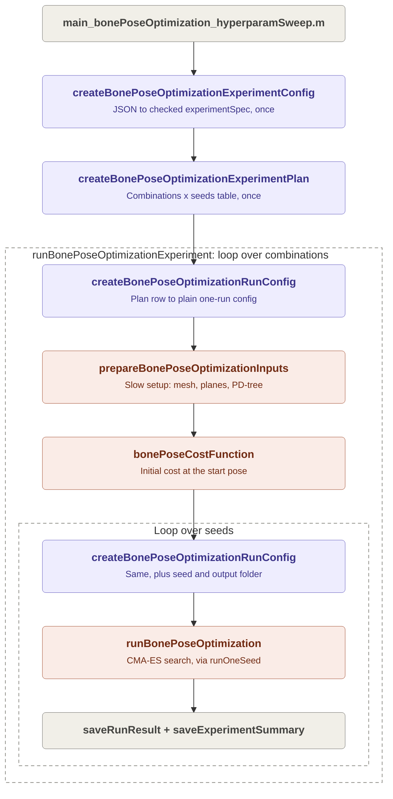
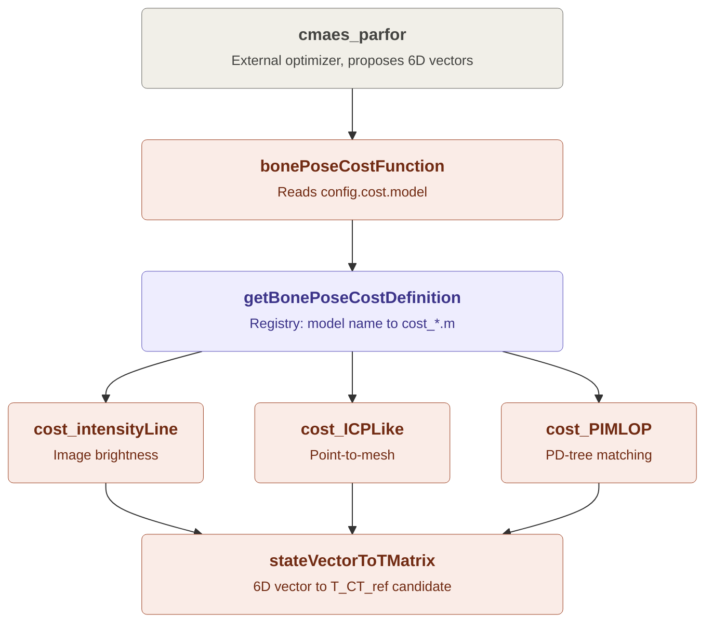

# Processing workflow

This page explains what happens when you run `main_bonePoseOptimization_hyperparamSweep.m`. A lot of code is involved, but the core idea fits in one sentence:

> Read the settings once, then for every combination of settings prepare the data once and run CMA-ES once per seed.

Everything else (saving, resuming, catching errors) is bookkeeping around those two loops. When you read the code for the first time, you can skip the bookkeeping. Once the loops make sense, [Bookkeeping](bookkeeping.md) explains how a sweep that runs all night keeps its results safe when something goes wrong.

The interactive script `main_bonePoseOptimization_oneSweep.m` uses the same functions. It runs exactly one combination with one seed, keeps the results in the workspace instead of saving them, and shows figures.

## 1. The big picture: two nested loops

Colours: purple boxes handle **configuration**, coral boxes do the **science and heavy computation**, and gray boxes are **bookkeeping**.

### 1.1. Why the loops are organised this way

- **Preparation is slow, and the seeds don't change it.** Loading the mesh and building the search trees can take a while. It depends on the settings of a combination, but not on the random seed. So it runs once per combination, and all seeds reuse the result.
- **Each run is saved the moment it ends.** A sweep can run all night. If MATLAB crashes at 3 a.m., every finished run is already on disk, and the sweep can be resumed later (see [Running the project](running.md)).
- **One failure does not stop the sweep.** A combination or seed that throws an error is recorded as `run_failed` in `summary.csv`, and the loop moves on. [Bookkeeping](bookkeeping.md) lists every failure case and what the sweep does about it.

## 2. Functions worth knowing

Read them in this order. The links open the source file.

### 2.1. Configuration: from JSON to one plain config

The JSON file describes *many* runs at once: lists of candidate values to try. The scientific code should not have to know about lists. It just wants "the" value of each setting. Three functions convert one shape into the next:

| Step | Function | Turns this... | ...into this | How often |
| --- | --- | --- | --- | --- |
| 1 | [`createBonePoseOptimizationExperimentConfig`](../functions/bonePoseOptimization/configuration/createBonePoseOptimizationExperimentConfig.m) | JSON file | `experimentSpec`: every setting checked, paths made absolute | Once |
| 2 | [`createBonePoseOptimizationExperimentPlan`](../functions/bonePoseOptimization/configuration/createBonePoseOptimizationExperimentPlan.m) | `experimentSpec` | A table with every combination of candidates, and one run per seed for each | Once |
| 3 | [`createBonePoseOptimizationRunConfig`](../functions/bonePoseOptimization/configuration/createBonePoseOptimizationRunConfig.m) | `experimentSpec` + one plan row | A plain config with one value per setting | Many times |

- **Step 1 is a safety check.** It reads the whole JSON up front, so a typo stops the sweep within seconds instead of halfway through the night. It also asks the cost model's validator (`validate_cost_<model>.m`) to check that model's parameters.
- **Step 2 is a to-do list.** If the JSON says "try 3 values for A and 2 values for B, with 5 seeds", the plan has 3 × 2 = 6 combinations and 6 × 5 = 30 runs. Every run gets a fixed ID, which the output folders and `summary.csv` also use.
- **Step 3 is called twice inside the loop:** once without a seed (the config used for preparation) and once per seed (the config handed to CMA-ES, which also includes that run's own output folder).

### 2.2. The conductor: `runBonePoseOptimizationExperiment`

[`runBonePoseOptimizationExperiment`](../functions/bonePoseOptimization/runBonePoseOptimizationExperiment.m) strings all the other pieces together. The file is long, but the actual flow lives in one local function, `runAllCombinations`. The other local functions only package results into structs and tables and save them, so you can treat them as a black box.

It also creates the timestamped experiment folder, keeps `experiment_log.txt`, and handles resuming a stopped sweep.

### 2.3. Preparation: `prepareBonePoseOptimizationInputs`

[`prepareBonePoseOptimizationInputs`](../functions/bonePoseOptimization/inputPreparation/prepareBonePoseOptimizationInputs.m) does all the slow work *before* optimization starts:

- loads the CT mesh, the tracked ultrasound image planes, the coarse start pose, and (if the cost model needs it) the segmented bone surface;
- picks out the target bone (for example `F` for femur);
- builds search structures such as the PD-tree used by P-IMLOP;
- smooths the ultrasound images when the `intensityLine` cost needs them.

It returns two structs:
- `data` holds everything the cost function may read. It is the hand-off point: built once, then read thousands of times by the cost function.
- `validationData` holds the ground truth. The optimizer never sees it, so it cannot cheat. It is used only afterwards, to measure the error.

### 2.4. The optimizer: `runBonePoseOptimization`

[`runBonePoseOptimization`](../functions/bonePoseOptimization/runBonePoseOptimization.m) sets up CMA-ES (search bounds, step size, seed, output folder) and then calls the external optimizer `cmaes_parfor` with `bonePoseCostFunction` as the function to minimise. Afterwards it turns the best result into the transforms `T_CT_ref_best` and `T_bone_ref_best`.

In the experiment runner, it is called through the local function `runOneSeed`. That function times the run, catches errors, and re-evaluates the best pose once to store its cost details.

## 3. Inside one cost evaluation

During a single CMA-ES run, the optimizer proposes thousands of candidate poses. For each one, it calls the cost function, which is a short chain:

### 3.1. The 6D pose vector: `stateVectorToTMatrix`

This is the most important idea to understand. CMA-ES does **not** search for the bone pose directly. It searches for a small *correction* `[vx; vy; vz; wx; wy; wz]` on top of the coarse start pose `T_CT_ref_initial`:

- the first three values are a translation in millimetres;
- the last three are a rotation (a rotation vector, in radians);
- a zero vector means "no correction", so exactly the coarse start pose.

[`stateVectorToTMatrix`](../functions/bonePoseOptimization/poseEvaluation/stateVectorToTMatrix.m) turns that vector into a 4×4 candidate transform `T_CT_ref_candidate`. Every cost model starts with this call, then places the CT mesh at the candidate pose and scores it. [`TMatrixToStateVector`](../functions/bonePoseOptimization/poseEvaluation/TMatrixToStateVector.m) does the reverse.

### 3.2. The dispatcher and the registry

- [`bonePoseCostFunction`](../functions/bonePoseOptimization/bonePoseCostFunction.m) is the one cost function that CMA-ES and the scripts always call. It has no science inside: it reads `config.cost.model` (for example `'PIMLOP'`) and forwards the call to the matching model.
- [`getBonePoseCostDefinition`](../functions/bonePoseOptimization/costModels/getBonePoseCostDefinition.m) is the registry: a single `switch` that links each model name to its evaluator `cost_<model>.m` and its validator `validate_cost_<model>.m`. Configuration and the dispatcher both use it, so they always agree on which models exist.

Because of this split, adding a new cost model never changes the optimizer or the runner. You add the two files and one `case` in the registry (see [Adding a new cost function](adding-a-cost-function.md)).

### 3.3. The cost models

Each `cost_<model>.m` answers one question: "how well does the bone at this candidate pose agree with the ultrasound data?" It returns one number, and **lower is better**.

- `cost_intensityLine`: cuts the mesh with each image plane and measures how bright the image is along the cut lines. A real bone surface shows up as a bright echo.
- `cost_ICPLike`: measures the distance from the segmented ultrasound bone points to the mesh surface.
- `cost_PIMLOP`: matches the segmented points to the mesh with a probabilistic model that also uses the surface normals, using the PD-tree built during preparation.
- `cost_intensityICP` and `cost_intensityPIMLOP` (not drawn) just combine `cost_intensityLine` with `cost_ICPLike` or `cost_PIMLOP`.

The details and parameters of every model are in [Supported cost functions](cost-functions.md).

## 4. Where to look next

- To learn how results are saved, what can go wrong during a sweep, and how a stopped sweep continues: [Bookkeeping](bookkeeping.md).
- To run a sweep or resume one: [Running the project](running.md).
- To find out what each saved file contains: [Output structure](output-structure.md).
